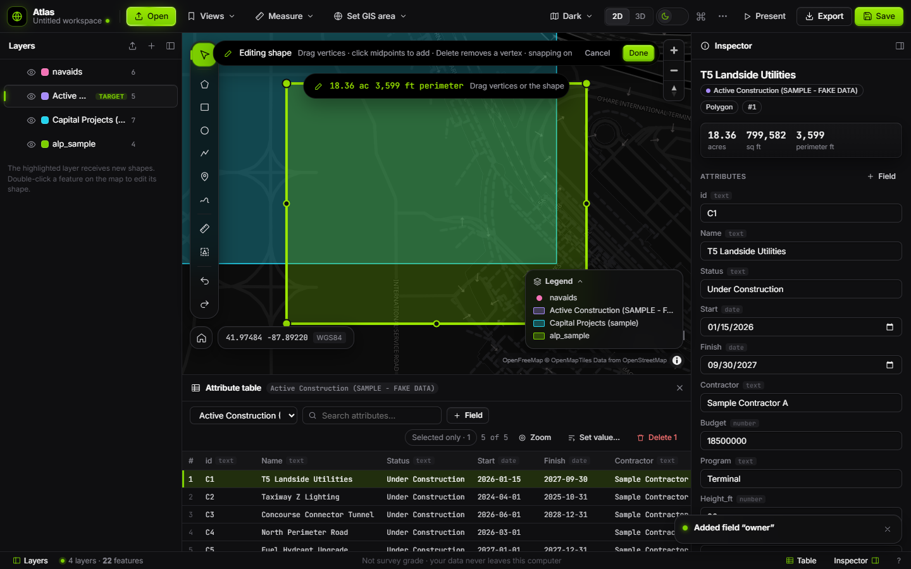
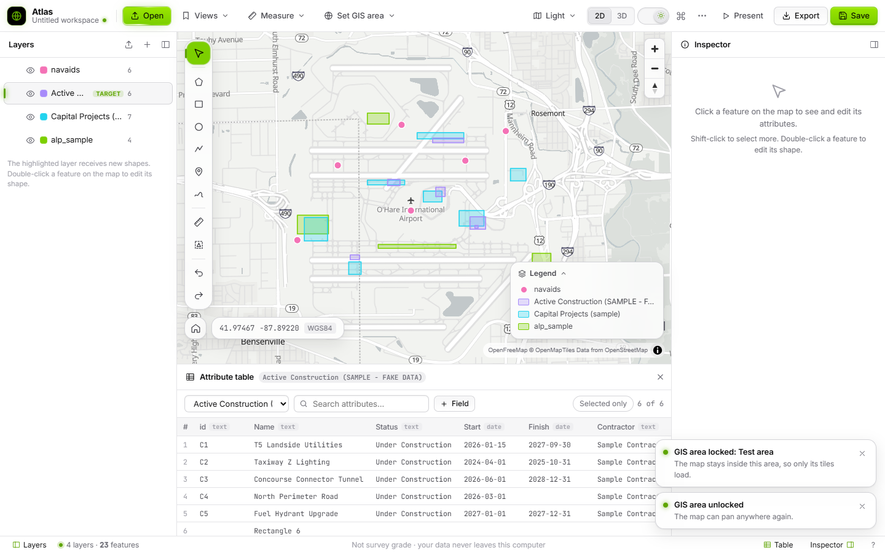

# Atlas

A simple, fast, **browser-only GIS**. Open shapefiles, KML/KMZ, GeoJSON, CSV and AutoCAD DWG, then edit shapes **and** attribute tables, add fields, measure, buffer, print and export. Everything is one `dist/Atlas-GIS.html`. There's nothing to install and no server, and your data never leaves your computer.

## Run it
1. Download or clone this repo.
2. **Double-click `dist/Atlas-GIS.html`.** Chrome or Edge is recommended (it needs an internet connection for the map libraries and basemaps).
3. Click **Open**, or drop files anywhere on the map.

## What you can do
- **Open data:** Shapefile (`.zip`, the parts picked together, or just the `.shp`: Atlas asks once for its folder and loads the `.dbf`/`.prj` itself), KML, KMZ, GeoJSON, CSV with lat/lon columns. Projected data is reprojected from its `.prj`, or from a coordinate system you pick.
- **Edit shapes:** the highlighted (**Target**) layer receives new polygons, rectangles, circles, lines, points and freehand shapes. **Double-click** any feature (or press `E`) to drag vertices. Snapping to nearby vertices is on by default. Multi-part shapes can be exploded into parts.
- **Edit attributes:** double-click a table cell, or use the inspector. Shift/Ctrl-click to select many, then *Set value…* or *Delete*. Undo and redo cover everything (`Ctrl+Z` / `Ctrl+Shift+Z`).
- **Manage fields:** add (text, number, date, yes/no, with a default), rename, change type, delete, all from the table's column menu or *Fields…*.
- **GIS Area:** **Set GIS area** locks the map to the place you work: the current view, a drawn box, a layer's extent, typed coordinates, or a saved area (Chicago O'Hare ships as a preset). The map then never loads tiles from anywhere else, which keeps it fast.
- **Style:** colors, opacity, labels, color by field, and 3D extrusion by a height field.
- **Measure and buffer** in feet, miles and acres.
- **Export** (`Shift+E`):
  - map print (Letter/Tabloid/ANSI D, PDF or PNG, with title block, legend, north arrow and scale)
  - data export (Shapefile, GeoJSON, KML, CSV; all features or the selection)
  - copy the map image
  - present full screen
- **Open a folder** (Chrome/Edge) loads every dataset in it, with all shapefile parts, in one pick. Atlas remembers folders you've opened.
- **Share a project:** *Export → Project package* makes one `.zip` holding the project file and every layer as shapefiles. Whoever gets it drops the zip on Atlas to reopen everything, or unzips it to use the shapefiles in ArcGIS or QGIS.
- **Workspaces** save everything to one `.atlas.json`. The last session autosaves in the browser. Old ORD Spatial Model `.ordws.json` files still open.

Press `Ctrl+K` for the command palette, or `?` for keyboard shortcuts.

## Performance tips
- Lock a **GIS Area**. It limits panning, zoom-out and tile downloads to that area.
- **Performance mode** (basemap menu or Settings) lowers resolution and turns off 3D buildings, terrain, blur and animation.
- 3D terrain is off unless you turn it on.

## Privacy
Files are read locally. The only network requests are for the pinned map libraries (jsDelivr), basemap tiles (OpenFreeMap, Esri imagery), terrain tiles (AWS) and fonts (Google Fonts). There's no analytics.

## Development
- The app is `dist/Atlas-GIS.html`. Read `CLAUDE.md`, `PRD.md` (requirements, FR IDs) and `DESIGN.md` (tokens and component recipes) before changing it.
- Unit tests: `node --test tests/`
- Browser smoke test over `file://`: `npm i --no-save playwright-core && node tests/smoke.browser.mjs` (needs a Playwright Chromium install).
- Synthetic sample data: `samples/`, regenerated with `node scripts/make-samples.mjs`.
